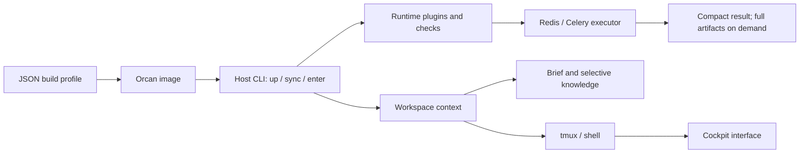

# Orcan flow: build, runtime, interfaces and context

Orcan manages local working context and processes. Agents remain separate tools;
Orcan does not choose a model or send their conversations to another model.



## One operation at a time

1. Choose installed agents and optional tools using the [JSON build profile](image-profiles.md).
   `orcan build --config image.json --plan` previews it; repeat without `--plan` to build.
2. `orcan sync` applies workspace and runtime configuration. It does not rebuild software.
3. `orcan up` starts the container. Access and services are explicit capabilities:
   `--with-ssh`, `--with-docker`, `--with-redis`, `--with-ttyd` or `--with-ttyd-auth USER:PASS`.
4. `orcan enter` opens the default cockpit interface. `orcan enter --shell`,
   `orcan enter --tmux SESSION` and `orcan attach WORKSPACE` provide direct routes.
5. Generated workspace instructions describe installed agents, the current executor
   capability, small results, selective memory and handoff. Existing conversations
   should reread instructions after an image/configuration change.

Use `--with-ssh` for host SSH keys/agent access. Git itself is already installed.
`--ssh` and `--with-git` remain compatibility aliases. Existing saved start flags
remain readable. `orcan up --resume` restores the last requested capability set;
credentials used for ttyd authentication still need to be supplied again.

## Built-in plugins

The `plugins/` directory contains declarative descriptors for the current built-in
capabilities. They identify a role, supported flags and a fixed verifier, without
executing arbitrary descriptor-provided commands.

| Plugin | Responsibility | Verification |
| --- | --- | --- |
| ssh | Host SSH mount/agent access | Capability marker and mount/socket presence; no remote login |
| docker | Host Docker socket access | Socket presence/access, without executing project containers |
| ttyd | Browser terminal | Local listener; authentication is a mode of this plugin |
| executor | Background queue, worker and result flow | Broker and worker readiness via executor doctor |
| cockpit | UI over workspace/tmux | UI/tmux availability and container resource diagnostics |

```sh
orcan plugins list
orcan plugins validate
orcan plugins doctor
orcan plugins doctor --plugin executor
```

`validate` checks that declared flags have CLI handlers. `doctor` is a finite,
read-only runtime check, not a polling listener. A disabled capability is reported
as disabled rather than as an error. Cockpit availability does not claim that every
UI session is responsive. Its resource report shows cgroup memory usage/limit/events
and free disk space, not model memory, GPU usage or a diagnosis of a past freeze.
The registry organizes existing built-ins; it is not an external plugin marketplace
or a promise that every base dependency can already be removed from the image.

## Selective memory instead of permanent chat context

There are two levels:

- The workspace `.orcan/session-brief.md` holds the current goal, decisions,
  verification status, blockers and next action. A handoff recap updates this same
  brief and archives the previous version. It is not another competing transcript.
- Explicit knowledge notes hold stable facts with tags, sources, timestamps and
  revision hashes. Project notes in Git repositories live in the Git common
  directory, so they are shared across branches/worktrees and survive removal of
  an agent's task checkout. Workspace notes remain in workspace metadata; removing
  that workspace also removes its metadata under the existing workspace policy.

```sh
orcan memory --project /canonical/repo remember build-tests \
  --title 'Selected test workflow' --text 'Use the checked-in selected procedure.' \
  --tag tests --source README.md
orcan memory --project /canonical/repo search 'selected tests' --limit 3 --budget 3000
orcan memory --project /canonical/repo show build-tests
orcan memory --project /canonical/repo status
```

Inside Orcan, the equivalent command is `orcan-memory`. Global scope options go
before the subcommand. An explicit non-Git project directory uses its own metadata.
Search uses local SQLite FTS5 lexical ranking with title/tag boosts; it is not
semantic inference or a confidence score. Sources and timestamps help an agent
check relevance and freshness. Only supplied notes are indexed: no automatic
repository crawl, chat import, archive scan, embedding service or AI call runs.

Search defaults to three bounded excerpts and 3000 UTF-8 output bytes. Read one
full note only when its excerpt is relevant. Stores are limited to 200 notes,
8000 UTF-8 text bytes each, and bounded tags/sources. Updating or forgetting a note
requires its current `--expected-sha256`, preventing silent overwrites by another
agent. Keep verified facts, not full logs, guesses, repeated instructions or secrets.
Memory does not override repository instructions or source files.

For handoff, the agent writes a recap into a separate file:

```sh
orcan compact --workspace /workspace --check
orcan memory --workspace /workspace recap --file recap.txt --expected-sha256 HASH
```

A first recap can omit the expected hash when there is no existing brief. Later
updates require it. Recaps have the existing 800-word/8000-byte budget and may be
longer than the prior recap while staying within that budget. `orcan compact`
retains its stricter requirement that compaction makes an existing brief smaller.
History remains on demand. The active agent writes summaries; Orcan does not invoke
an agent automatically or copy whole sessions into permanent memory.

## Bounded work under pressure

Tmux history is separately bounded by `tmux.history_limit` (default 20000 lines,
range 1000..200000). The previous image default was 100000. Configure it in JSON,
sync and recreate the container for the environment-backed setting; already
running panes are not forcibly cleared or compacted by this change.

The cockpit uses time and byte budgets per PTY callback, with a bounded chunk size,
then returns to the event loop. Linux's readable-fd notification schedules the next
read; it does not accumulate an extra self-scheduling callback chain during output
floods. This provides backpressure rather than dropping terminal output. Brief
previews and reconnect-state reads are bounded before decoding/parsing.

```json
{
  "cockpit": {
    "pty_read_bytes": 262144,
    "pty_read_ms": 8,
    "pty_chunk_bytes": 16384,
    "peek_chars": 1200
  }
}
```

These are runtime settings: sync and restart the cockpit session to use them.
They do not reserve RAM/disk, cap a child agent's memory, limit tmux's own history,
or guarantee availability after container OOM or disk exhaustion. `resources`
controls container limits. Direct shell/tmux access is useful when diagnosing the
UI separately. No live container settings are changed merely by checking diagnostics.

For [background checks](background-executor.md), return control after submitting an
exact committed SHA. Successful stdout never enters agent completion messages.
Failure excerpts are bounded; full logs/XML are consumed in explicit chunks.
Dashboard instrumentation stays out of agent results. A background process avoids
blocking a turn, but does not itself make tests faster or prove token-cost savings.
